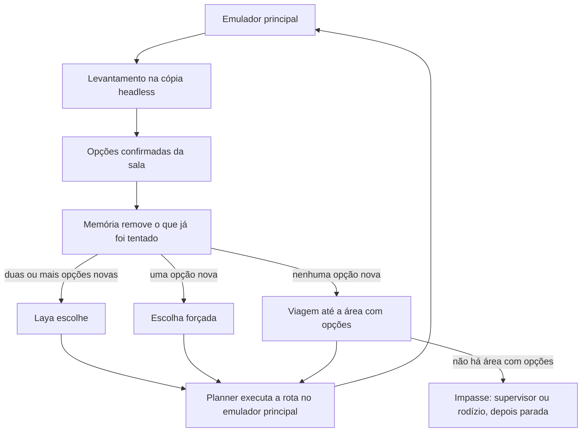

# ADR 0001: o Laya escolhe entre opções descobertas por simulação, e a memória impede loops

- **Status:** aceito
- **Data:** 20 de novembro de 2026, com revisão no mesmo dia (luta, itens, camadas e contexto curto)
- **Contexto de execução:** Oracle of Ages US no PyBoy 2.8.1, Laya 0.5.0 local em CPU

## Contexto

O objetivo do projeto é o Laya terminar Oracle of Ages jogando sozinho. Duas abordagens anteriores não chegam lá.

**O Laya escolhendo botões.** No cenário de saída, o Laya escolheu "direita" 12 vezes seguidas contra a parede. Isso se repetiu em texto e em JSON, com e sem histórico. A probabilidade da opção escolhida era 0,31, quase igual à das outras. Mudar o texto do prompt não mudou o resultado.

**A campanha com rotas escritas à mão.** `zelda_env/campaign.py` leva o jogo até o marco 19 com objetivos e coordenadas fixas. O Laya só escolhe entre A e B nos diálogos. A partir do seed gerado pelo boot, essa campanha para no marco 06, porque um personagem não está na coordenada esperada.

A [spec](../spec-portabilidade-windows-linux.md), seção 8.2, pede que o Laya escolha entre subobjetivos legais e que o planner traduza a escolha em inputs.

## Decisão

O agente em `zelda_env/agent.py` repete quatro passos a cada decisão.



### 1. O levantamento descobre as opções

`zelda_env/survey.py` mantém um segundo PyBoy sem janela. A cada decisão ele carrega o estado atual nessa cópia e faz uma busca em largura com passos de 12 frames nas quatro direções. Cada resultado diferente vira uma opção, com a rota de inputs que leva até ele:

| Tipo | Como é detectado |
| --- | --- |
| `exit` | Um passo muda a sala. A sala de destino já é conhecida antes de ir. |
| `interact` | Um passo é bloqueado, ou há um personagem à frente, e apertar A ou B abre diálogo, muda o terreno ou muda o progresso. |
| `push` | Segurar a direção por 60 frames move o objeto ou muda o estado, e esperar o mesmo tempo sem empurrar não muda. |
| `trigger` | Um passo, ou ficar parado 150 frames, tira o jogo do controle normal. |
| `fight` | Há inimigo na sala e uma luta de espada simulada mata um deles dentro do limite de dano. |
| `item` | Um item que não é a espada, usado no tile à frente, muda o terreno. Vale para chão livre, como cavar com a pá. |

**Luta.** A cópia headless parte do estado exato do jogo, inclusive o gerador aleatório. Uma luta que dá certo nela se repete igual no emulador principal. O levantamento testa nove táticas: perseguir o inimigo contornando obstáculos, ou ficar parado e golpear quando ele se aproxima. A primeira que mata um inimigo vira a rota da opção. Primeiro sem dano; depois aceitando até um coração, se sobrarem dois.

**Camadas.** O levantamento roda em três níveis de detalhe: passos de 16 px, de 12 px e de 12 px com grade de 4 px. O nível rápido roda sempre. O seguinte roda quando a área não tem nada novo ou parece um beco sem saída. O mais fino roda só quando nenhuma outra área conhecida tem opções. O nível rápido leva cerca de um terço do tempo do seguinte.

**Salas que mudam sozinhas.** Em algumas salas os tiles mudam com o tempo. O levantamento detecta isso esperando 30 frames no início e, nesse caso, não usa mudança de tile como prova de efeito.

Rotas que causam dano são descartadas. Os testes de interagir, empurrar e esperar também conferem a vida, inclusive o dano que chega com atraso, como cair num buraco.

**Comparação local.** Cada teste é comparado com o instante imediatamente anterior a ele, e não com o início do levantamento. Em algumas salas a porta se fecha atrás de Link alguns frames depois da entrada. Comparado com o início, todo teste posterior parecia ter efeito.

**Empurrar.** O teste segura a direção por 32, 44 ou 60 frames e fica com a duração mais curta que move algo sem causar dano, porque depois que o bloco anda Link continua andando e pode cair. Antes de empurrar, Link é alinhado ao centro do tile. Um passo curto que termina encostado em algo conta como bloqueio e é mantido na busca, mesmo numa célula já visitada: é assim que a soleira de uma porta é alcançada.

**Itens guardados.** Um item que está no inventário, fora dos botões, é testado na cópia headless como se estivesse equipado. Quando tem efeito, a rota da opção inclui abrir o menu e equipar com botões reais, e a rota inteira é repetida na cópia antes de ser oferecida. O emulador principal só recebe inputs de controle. Nada é escrito na memória do jogo.

O levantamento usa a simulação em vez de decodificar colisão. A leitura de colisão só cobre salas pequenas e não inclui objetos, personagens e itens.

### 2. A memória define as candidatas

`Memory` guarda, por área e por estado da história, quantas vezes cada opção foi tentada. Só as opções com zero tentativas vão para o Laya. Esta é a regra que impede loops. Ela está no código e não depende do modelo.

Quatro definições sustentam a regra:

- **Estado da história.** Um hash de tesouros, flags globais, essências, chaves, itens equipados e flags de sala, sem o bit de sala visitada. Cada estado tem seu próprio registro. Uma flag que liga e desliga volta ao registro anterior em vez de zerar a memória.
- **Área.** A sala mais o conjunto de saídas alcançáveis. Uma sala com partes sem ligação vira mais de uma área.
- **Identidade pelo resultado.** O id de uma conversa inclui o texto que o personagem diria agora. A mesma fala não é oferecida de novo. Uma fala nova é uma opção nova.
- **Progresso reabre o mapa.** Quando a história avança, as saídas voltam a ser candidatas. Conversas, empurrões e eventos já feitos continuam feitos.

### Salas que se refazem

Nas dungeons, uma sala volta ao estado inicial quando Link sai: blocos voltam ao lugar e portas fecham. Três mecanismos tratam isso sem tornar tudo "novo" a cada visita.

- **Receita de travessia.** Ao sair de uma sala, o agente guarda o que fez nela entre entrar por um lado e sair pelo outro. Para atravessar de novo com a saída fechada, repete esses passos. Sem receita, usa o que já sabe que abriu aquela saída e, na falta disso, as ações da sala ainda não feitas na visita.
- **Viagem sala a sala.** O planejamento usa todas as saídas já vistas de cada sala, mesmo as fechadas no momento, apoiado nas receitas.
- **Áreas unidas.** Quando um levantamento mostra que duas áreas de uma sala se ligam, por exemplo depois de um bloco empurrado, os registros das duas são unidos.

### Objetivo dentro de uma dungeon

Um objetivo pode nomear a dungeon em que acontece. Enquanto Link está nela, sair para uma sala do mundo aberto já visitada não é candidata, e as viagens só miram salas da própria dungeon. Uma saída para uma sala do mundo aberto nunca visitada continua valendo: é o caminho adiante. Fora dela, uma saída conhecida que leva à dungeon é tomada de imediato. Em qualquer outro interior, o objetivo vira `Go outside.` e o agente segue o mapa conhecido até a porta.

Quando a sala de referência do objetivo já foi visitada, o agente segue o mapa que construiu até ela, em vez da direção.

### Sala de referência com partes sem ligação

A sala de referência de uma etapa pode ter partes que não se ligam, e a tarefa fica em uma só delas. Quatro regras tratam isso:

- **Entrada nova primeiro.** Uma saída ainda não usada que leva à sala de referência vem antes de qualquer caminho conhecido.
- **Parte esgotada.** Quando não sobra nada a fazer na parte em que Link está, ela é marcada como esgotada. Os caminhos conhecidos deixam de mirar essa parte.
- **Refazer a tarefa tem limite.** Na sala de referência, o que combina com a tarefa pode ser refeito, até três vezes por ação.
- **Avanço de etapa.** A etapa só avança quando Link sai da sala de referência para um mapa nunca visto ou para o mapa da etapa seguinte.

### Abertura de caminho

Quando uma ação faz surgir uma saída, o agente guarda a ação como o que abre aquela saída e a refaz quando a saída está fechada. Só conta como abertura a saída que surge com mudança de terreno ou depois de uma conversa. Uma saída que apareceu porque o levantamento seguinte foi mais detalhado não é atribuída à ação.

### Perguntas no diálogo

O agente avança cenas e diálogos sozinho até Link voltar a ser controlável. Quando o jogo faz uma pergunta com opções, ele confirma a primeira. Se a mesma pergunta volta na mesma cena, confirma a seguinte, em rodízio. Isso resolve perguntas como "devo repetir?", em que a primeira resposta reinicia a explicação.

### 3. O Laya escolhe, com a origem registrada

Com duas ou mais candidatas, o Laya recebe só um objetivo curto e até doze opções curtas. Exemplo: objetivo `Go north.` e opções `Go north to a new room`, `Talk to the character`, `Attack the enemy`.

O texto curto foi uma decisão medida. Em 23 decisões reais com uma saída na direção do objetivo, o Laya escolheu essa saída em 9 com o contexto longo (objetivo em frase, sala, posição, histórico) e em 23 com o contexto curto, com confiança média de 0,87. O acaso daria 6,5.

Com mais de doze candidatas, as que combinam com o objetivo ficam na lista e as mais distantes saem. Uma opção de obstáculo diz o lado da sala em que ele está (`Use the item on the obstacle to the east`), exceto quando há uma saída livre na direção do objetivo.

Cada objetivo é uma lista de etapas escrita à mão, com uma sala de referência e o que fazer ao chegar, mais um teste lido da memória do jogo que o encerra. Enquanto Link está no mesmo mapa da sala de referência, o objetivo é a direção até ela, com uma direção só: a de maior distância que tenha saída disponível. Em outro mapa, como um interior, o objetivo é um texto fixo, por exemplo `Go to a new room.`. As salas e flags vêm do disassembly. Não há rota nem coordenada.

Cada decisão registra a origem no `trace.jsonl`:

| Origem | Quando |
| --- | --- |
| `laya` | O Laya escolheu entre duas ou mais opções novas. |
| `forced` | Só havia uma opção nova. |
| `frontier` | Não havia opção nova na área. O agente deu o primeiro passo do caminho conhecido mais curto até uma área com opções. |
| `supervisor` | O LLM pequeno escolheu. |
| `route` | O agente seguiu o mapa conhecido até a sala de referência, até a saída de um interior ou até a dungeon do objetivo. |
| `recipe` | Um passo da receita de travessia de uma sala que se refez. |
| `sweep` | Não havia nada pendente. O agente foi em direção à sala conhecida vista há mais tempo. |
| `fallback` | Não havia opção nova em lugar nenhum. O agente pegou a opção menos tentada. |

### 4. Ciclos são cortados e o impasse termina a execução

As regras acima reduzem a repetição, mas a garantia final é um detector que não depende delas. Doze decisões seguidas feitas de no máximo quatro movimentos distintos, ou um mesmo movimento feito seis vezes em oitenta decisões, contam como ciclo. Os movimentos do ciclo deixam de ser oferecidos como novos, as pendências são descartadas e a decisão é refeita. O evento fica no trace como `loop_cut`.

O corte remove das pendências só os movimentos do ciclo. As outras pendências continuam valendo.

Sem nada pendente, o agente varre as salas conhecidas, da vista há mais tempo para a mais recente. Depois de 80 decisões de varredura sem progresso na história, ou de um rodízio local sem novidade, registra `impasse` e para. O último estado fica salvo.

Se Link fica sem nenhuma opção, por exemplo cercado por um bloco empurrado para o lado errado, o agente volta ao estado anterior à decisão que causou isso e não a oferece mais naquele ponto. O mesmo vale para uma decisão que mata Link.

### Supervisor

`zelda_env/supervisor.py` consulta um LLM pequeno no Ollama local. Ele recebe o mesmo contexto e a lista de candidatas, e devolve o id de uma delas ou `abstain`. O supervisor escolhe só entre opções que já passaram pela memória. Ele não gera inputs.

O código rejeita JSON inválido, id fora da lista e resposta depois de 20 segundos. O orçamento é de duas consultas por impasse, com seis decisões de intervalo. Sem servidor ou sem pesos, o agente roda sem supervisor.

## Consequências

**O que melhora**

- O agente não repete uma ação sem efeito. Em 30 mundos aleatórios de teste, a exploração sempre termina.
- O agente descobre mecânicas que ninguém programou: empurrar a pedra, cortar o arbusto com a espada, voltar ao urso na hora certa.
- Uma variação pequena de estado não quebra a execução, porque não há coordenada fixa.

**O que custa**

- Cada decisão leva de 3 a 5 segundos de levantamento em um Apple M3 Pro. A inferência do Laya leva cerca de 0,25 segundo.
- A exploração é larga quando o Laya escolhe mal a direção. A memória garante que ele não repete, mas não que ele vá pelo caminho mais curto.
- O Laya decide menos do que parece. Em parte das decisões só há uma opção nova.

**O que não está coberto**

- Combate além da espada: chefes com padrão próprio, inimigos que exigem outro item e projéteis.
- Recuperar vida. O agente evita dano e desfaz a decisão que mata, mas não procura corações.
- Menu, equipar item e escolhas de sim ou não com consequência. O jogo equipa sozinho os dois primeiros itens; a partir do terceiro é preciso o menu.
- Puzzles que exigem uma sequência de ações na mesma sala sem mudança visível entre elas.

O menu de itens é pré-requisito para terminar a primeira dungeon, que entrega um terceiro item.

## Alternativas consideradas

| Alternativa | Por que não |
| --- | --- |
| Ajustar o prompt do Laya | Já testado em quatro formatos. O Laya repete a mesma escolha errada. |
| Só filtrar direções bloqueadas | O Laya parou de colidir, mas não achou a saída em 12 decisões. |
| Exploração aleatória depois de bloqueios | Chegou à saída em 7 de 10 sementes. Não garante término e não serve para conversas e objetos. |
| Mais marcos escritos à mão | Leva o jogo adiante, mas o Laya não decide, e as coordenadas quebram com variação de estado. |
| LLM maior decidindo tudo | Fora do objetivo do projeto, que é avaliar o Laya. O LLM pequeno fica restrito a impasses. |

## Como verificar

```bash
.venv/bin/python -m pytest
.venv/bin/python -m zelda_env seed
.venv/bin/python -m zelda_env.agent --headless --fresh --decisions 150
```

O `summary.json` da sessão traz `objectives_reached`, `origins` e `max_repeats_of_one_option_in_one_story_state`. Os resultados medidos estão em [validation-agent.md](../validation-agent.md).
