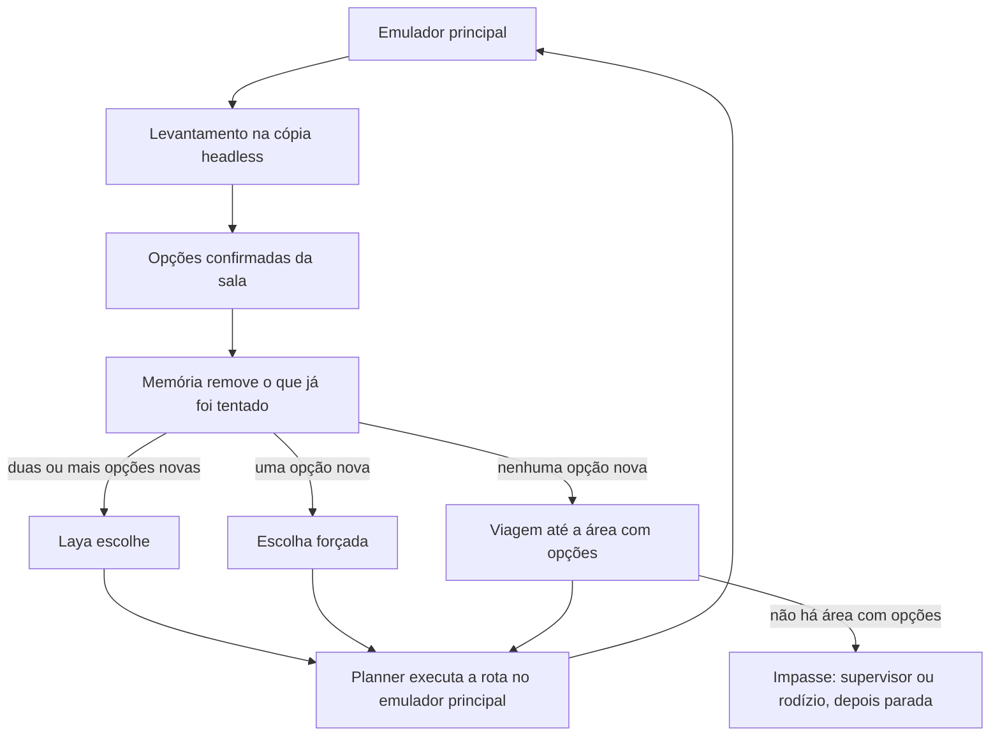

# ADR 0001: o Laya escolhe entre opções descobertas por simulação, e a memória impede loops

- **Status:** aceito
- **Data:** 20 de novembro de 2026
- **Contexto de execução:** Oracle of Ages US no PyBoy 2.8.1, Laya 0.5.0 local em CPU

## Contexto

O objetivo do projeto é o Laya terminar Oracle of Ages jogando sozinho. Duas abordagens anteriores não chegam lá.

**O Laya escolhendo botões.** No cenário de saída, o Laya escolheu "direita" 12 vezes seguidas contra a parede. Isso se repetiu em texto e em JSON, com e sem histórico. A probabilidade da opção escolhida era 0,31, quase igual à das outras. Mudar o texto do prompt não mudou o resultado.

**A campanha com rotas escritas à mão.** `zelda_env/campaign.py` leva o jogo até o marco 19 com objetivos e coordenadas fixas. O Laya só escolhe entre A e B nos diálogos. A partir do seed gerado pelo boot, essa campanha para no marco 06, porque um personagem não está na coordenada esperada.

A [spec](../spec-portabilidade-windows-linux.md), seção 8.2, pede que o Laya escolha entre subobjetivos legais e que o planner traduza a escolha em inputs.

## Decisão

O agente em `zelda_env/agent.py` repete quatro passos a cada decisão.



### 1. O levantamento descobre as opções

`zelda_env/survey.py` mantém um segundo PyBoy sem janela. A cada decisão ele carrega o estado atual nessa cópia e faz uma busca em largura com passos de 12 frames nas quatro direções. Cada resultado diferente vira uma opção, com a rota de inputs que leva até ele:

| Tipo | Como é detectado |
| --- | --- |
| `exit` | Um passo muda a sala. A sala de destino já é conhecida antes de ir. |
| `interact` | Um passo é bloqueado, ou há um personagem à frente, e apertar A ou B abre diálogo, muda o terreno ou muda o progresso. |
| `push` | Segurar a direção por 60 frames move o objeto ou muda o estado, e esperar o mesmo tempo sem empurrar não muda. |
| `trigger` | Um passo, ou ficar parado 150 frames, tira o jogo do controle normal. |

Rotas que causam dano são descartadas. O emulador principal só recebe inputs de controle. Nada é escrito na memória do jogo.

O levantamento usa a simulação em vez de decodificar colisão. A leitura de colisão só cobre salas pequenas e não inclui objetos, personagens e itens.

### 2. A memória define as candidatas

`Memory` guarda, por área e por estado da história, quantas vezes cada opção foi tentada. Só as opções com zero tentativas vão para o Laya. Esta é a regra que impede loops. Ela está no código e não depende do modelo.

Quatro definições sustentam a regra:

- **Estado da história.** Um hash de tesouros, flags globais, essências, chaves, itens equipados e flags de sala, sem o bit de sala visitada. Cada estado tem seu próprio registro. Uma flag que liga e desliga volta ao registro anterior em vez de zerar a memória.
- **Área.** A sala mais o conjunto de saídas alcançáveis. Uma sala com partes sem ligação vira mais de uma área.
- **Identidade pelo resultado.** O id de uma conversa inclui o texto que o personagem diria agora. A mesma fala não é oferecida de novo. Uma fala nova é uma opção nova.
- **Progresso reabre o mapa.** Quando a história avança, as saídas voltam a ser candidatas. Conversas, empurrões e eventos já feitos continuam feitos.

### 3. O Laya escolhe, com a origem registrada

Com duas ou mais candidatas, o Laya recebe o objetivo atual, a sala, a posição, os três últimos resultados e a descrição de até oito opções. O objetivo é uma dica de texto com um teste lido da memória do jogo. Não contém rota nem coordenada.

Cada decisão registra a origem no `trace.jsonl`:

| Origem | Quando |
| --- | --- |
| `laya` | O Laya escolheu entre duas ou mais opções novas. |
| `forced` | Só havia uma opção nova. |
| `frontier` | Não havia opção nova na área. O agente deu o primeiro passo do caminho conhecido mais curto até uma área com opções. |
| `supervisor` | O LLM pequeno escolheu. |
| `fallback` | Não havia opção nova em lugar nenhum. O agente pegou a opção menos tentada. |

### 4. O impasse termina a execução

Sem opção nova em nenhuma área conhecida, o agente consulta o supervisor, se houver, e depois tenta as opções em rodízio. Depois de seis decisões assim sem novidade, registra `impasse` e para. O último estado fica salvo.

### Supervisor

`zelda_env/supervisor.py` consulta um LLM pequeno no Ollama local. Ele recebe o mesmo contexto e a lista de candidatas, e devolve o id de uma delas ou `abstain`. O supervisor escolhe só entre opções que já passaram pela memória. Ele não gera inputs.

O código rejeita JSON inválido, id fora da lista e resposta depois de 20 segundos. O orçamento é de duas consultas por impasse, com seis decisões de intervalo. Sem servidor ou sem pesos, o agente roda sem supervisor.

## Consequências

**O que melhora**

- O agente não repete uma ação sem efeito. Em 30 mundos aleatórios de teste, a exploração sempre termina.
- O agente descobre mecânicas que ninguém programou: empurrar a pedra, cortar o arbusto com a espada, voltar ao urso na hora certa.
- Uma variação pequena de estado não quebra a execução, porque não há coordenada fixa.

**O que custa**

- Cada decisão leva cerca de 9 segundos de levantamento em um Apple M3 Pro. A inferência do Laya leva cerca de 0,25 segundo.
- A exploração é larga quando o Laya escolhe mal a direção. A memória garante que ele não repete, mas não que ele vá pelo caminho mais curto.
- O Laya decide menos do que parece. Em parte das decisões só há uma opção nova.

**O que não está coberto**

- Combate, HP e morte. O levantamento só evita rotas que causam dano na simulação.
- Itens que agem à distância ou em terreno livre, como cavar com a pá.
- Menu, equipar item e escolhas de sim ou não com consequência.
- Puzzles que exigem uma sequência de ações na mesma sala sem mudança visível entre elas.

Esses itens são pré-requisitos para a primeira dungeon.

## Alternativas consideradas

| Alternativa | Por que não |
| --- | --- |
| Ajustar o prompt do Laya | Já testado em quatro formatos. O Laya repete a mesma escolha errada. |
| Só filtrar direções bloqueadas | O Laya parou de colidir, mas não achou a saída em 12 decisões. |
| Exploração aleatória depois de bloqueios | Chegou à saída em 7 de 10 sementes. Não garante término e não serve para conversas e objetos. |
| Mais marcos escritos à mão | Leva o jogo adiante, mas o Laya não decide, e as coordenadas quebram com variação de estado. |
| LLM maior decidindo tudo | Fora do objetivo do projeto, que é avaliar o Laya. O LLM pequeno fica restrito a impasses. |

## Como verificar

```bash
.venv/bin/python -m pytest
.venv/bin/python -m zelda_env seed
.venv/bin/python -m zelda_env.agent --headless --fresh --decisions 150
```

O `summary.json` da sessão traz `objectives_reached`, `origins` e `max_repeats_of_one_option_in_one_story_state`. Os resultados medidos estão em [validation-agent.md](../validation-agent.md).
