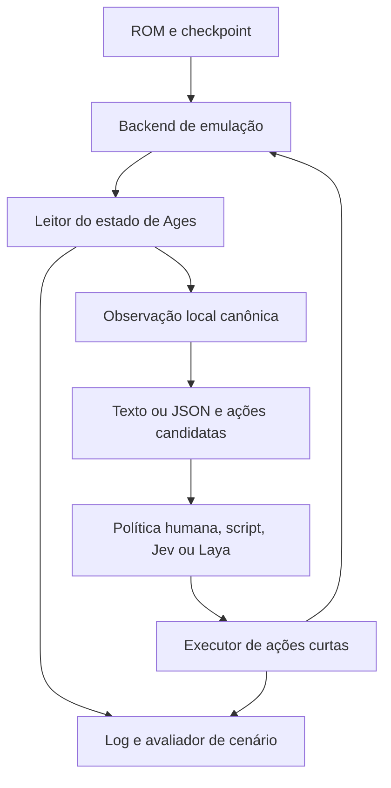

# Oracle of Ages: proposta para discussão

Data: 2026-10-28. Proposta, não implementação validada.

## Objetivo e evidência

O PDF fornecido define três tarefas iniciais: alcançar saída visível, aproximar-se de NPC e avançar diálogo. Não exige terminar a campanha, treinar pesos ou integrar Seasons. O documento foi tratado como fonte sobre a proposta acadêmica; as decisões abaixo são recomendações para discussão.

O workspace estava vazio. Não foi executada uma ROM nem instalada uma stack de emulação nesta pesquisa. A documentação e o código de terceiros indicam viabilidade; compatibilidade, fidelidade e esforço de portabilidade ainda precisam de experimento.

## Decisão proposta

Emular a ROM original com PyBoy, implementar o domínio de Ages em Python e aproveitar o disassembly e The Oracles Project como fontes para a leitura semântica. Fazer uma prova curta dessa combinação antes de fechar o backend. Alternativa: usar o core C e os leitores existentes de The Oracles Project com um binding/bridge, caso a portabilidade dos leitores para Python custe mais que a integração nativa.

Fontes: [PyBoy API](https://docs.pyboy.dk/api/pyboy.html), [disassembly](https://github.com/Stewmath/oracles-disasm), [core C](https://github.com/thibautbus/top/blob/main/engine/core/core.h), [hooks](https://github.com/thibautbus/top/blob/main/docs/GAME_HOOKS.md).

## Componentes



- **Backend**: avançar frames, enviar/soltar botões, capturar tela, ler memória com banco explícito, salvar/restaurar estado. Nenhuma semântica de Zelda aqui.
- **AgesReader**: perfil por hash da ROM e versão dos símbolos; interpreta posição, direção, grupo/sala, modo de jogo, transição, entidades, layout, colisões e texto. Leitura de memória durante episódios; inputs controlam o jogo.
- **ObservationBuilder**: recorta informação observável na tela atual, representa incerteza, mantém coordenadas locais e unidades explícitas. Separa o que é conhecido internamente do que o modelo pode receber.
- **ContextRenderer**: produz texto ou JSON a partir da mesma observação; histórico limitado de mudanças e resultados. Evita uma segunda interpretação divergente para cada formato.
- **ActionCatalog/Executor**: ações com IDs estáveis, descrição, pré-condições, limite de frames, condições de término e resultado. Impede input simultâneo de humano e modelo. Retorna `moved`, `blocked`, `room_changed`, `dialogue_opened`, `dialogue_advanced` ou `timeout` conforme evidência.
- **Policy**: contrato comum `choose(observation, candidates) -> action_id`. Implementações humana, script, aleatória e Jev/Laya. A semântica do jogo não depende do SDK.
- **ScenarioRunner**: checkpoint inicial, objetivo, predicado de sucesso, orçamento e logs. O avaliador pode acessar estado privilegiado que não entra no contexto.

## Primeiro contrato de ação

Começar com movimento curto nas quatro direções, interagir/confirmar, cancelar e esperar, condicionados ao modo atual. Calibrar deslocamento e duração em vez de supor que um metatile equivale sempre a um número fixo de frames. Microavanços internos permitem parar ao mudar sala, abrir diálogo, perder controle ou chegar ao limite. Sempre soltar botões ao encerrar.

Deixar `go_to(npc)` e rotas completas para uma segunda modalidade: um pathfinder embutido resolve parte da tarefa espacial e altera o que estamos medindo. Comparar representações mantendo candidatos e executor constantes. Máscaras de ações devem depender de regras locais declaradas, nunca do caminho ótimo para a meta.

Na decisão do modelo, a emulação fica parada; durante a execução de cada ação, o jogo evolui normalmente. Encerrar transições com orçamento explícito antes de oferecer nova observação estável. O modo humano pode rodar continuamente e ter pausa/avanço por ação para inspeção.

## Exemplo ilustrativo de contexto

Os valores abaixo são fictícios e não descrevem uma captura validada.

```json
{
  "goal": "Approach the visible character and start a conversation",
  "mode": "overworld",
  "player": {"local_tile": [4, 5], "facing": "north"},
  "nearby": [{"id": "npc_1", "relative_position": "two tiles north"}],
  "terrain": {"north": "clear", "east": "blocked", "south": "clear", "west": "unknown"},
  "dialogue": {"active": false},
  "recent_events": ["Last move east was blocked"],
  "available_actions": ["move_north", "move_south", "move_west", "wait"]
}
```

O SDK traduz os candidatos para uma pergunta Choice. JSON acima é o contrato interno proposto, não um payload completo da API. [State](https://docs.typesafe.ai/concepts/state) aceita texto e JSON; [Choice](https://docs.typesafe.ai/primitives/choice) seleciona uma opção entre critérios definidos. [Laya](https://github.com/NandhaKishorM/laya) oferece interface semelhante, mas diferenças de limite e confiança precisam de tratamento por backend. Inicialmente usar inglês para o contexto do Jev conforme sua documentação; idioma pode virar uma ablação posterior.

## Pontos técnicos a validar

1. ROM dos EUA e perfil de símbolos correspondente. Fixar hashes, commits e versões. Um save de SRAM não equivale a um savestate; checkpoints completos pertencem ao backend/versão que os produziu.
2. Link usa coordenadas subpixel e WRAM bancado; NPCs vêm das estruturas de objetos/interações, não de identificar apenas sprites.
3. Sala pequena tem layout de 10 por 8 metatiles, mas stride em RAM de 16. Salas grandes exigem outro tratamento. Tile gráfico, metatile e colisão não são equivalentes.
4. `wRoomCollisions` pode estar parcial durante transição. Passabilidade também depende de objetos, direção, estado e equipamento. Expor desconhecido quando o decoder não cobre um caso.
5. ID de texto não equivale à página já visível. A extração deve respeitar revelação, páginas, escolhas e substituições; não enviar o diálogo inteiro futuro ao modelo. O primeiro marco pode detectar/avançar diálogo sem transcrever tudo.
6. Nomes internos de objetos podem revelar identidade ou eventos que o jogador ainda não descobriu. Manter política explícita de observabilidade.

Fontes: [formatos](https://github.com/thibautbus/top/blob/main/docs/ROM_DATA_FORMATS.md), [hooks](https://github.com/thibautbus/top/blob/main/docs/GAME_HOOKS.md), [WRAM](https://github.com/Stewmath/oracles-disasm/blob/master/include/wram.s), [structs](https://github.com/Stewmath/oracles-disasm/blob/master/include/structs.s), [texto](https://github.com/Stewmath/oracles-disasm/blob/master/text/info.txt).

## Ordem de implementação sugerida

1. **Ambiente humano**: janela, teclado, pausa, captura e salvar/carregar checkpoint; manifesto da ROM local.
2. **Instrumentação**: painel com frame, sala, posição, modo e diálogo ao lado da imagem. Verificar observações por ações humanas conhecidas.
3. **Executor**: reproduzir a mesma sequência de ações desde o mesmo checkpoint e conferir estado final. Validar colisão e transição com scripts, antes de atribuir falhas ao modelo.
4. **Três cenários**: saída, aproximação e diálogo. Predicados distintos: trocar para sala-alvo; entrar em distância/facing de interação; abrir/avançar/encerrar página conforme a tarefa.
5. **Modelo**: Choice com candidatos curtos e contexto compacto. Registrar resposta, probabilidades, latência, payload enviado e truncamento.
6. **Experimentos**: texto versus JSON e sem/com histórico, executor e candidatos fixos. Usar múltiplos checkpoints e limites iguais; comparar humano/script/aleatório/Jev/Laya.

Métricas: sucesso por tarefa, decisões, frames emulados, latência de inferência, bloqueios/repetições, timeouts e fidelidade da observação. Falhas classificadas em extração/percepção, escolha e execução/sincronização.

## Relação com a literatura

[BALROG](https://arxiv.org/abs/2411.13543) ajuda a desenhar avaliação de agentes e observações textuais, mas não fornece Ages. [VideoGameBench](https://arxiv.org/abs/2505.18134) mostra a relevância de separar tempo de inferência de tempo do jogo e oferece o modo pausado Lite; usa entradas visuais, portanto não valida nosso adaptador semântico. Usar esses trabalhos como referência metodológica, sem comparar diretamente pontuações obtidas com informações diferentes.

## Perguntas para o brainstorming

- Meta principal: medir escolha espacial de baixo nível ou cumprimento de objetivos com macros de navegação?
- Observabilidade: apenas a tela atual e memória adquirida, ou permitir mapa global previamente conhecido?
- Primeiro cenário concreto e ROM/checkpoint disponíveis?
- Jev remoto, Laya local ou ambos como comparação desde o começo?

Minha preferência inicial: tela atual, ações curtas, PyBoy em Python, Jev/Laya intercambiáveis e navegação sem combate em três checkpoints curtos. Adiar mapa global, pathfinder e transcrição completa de todos os diálogos.
